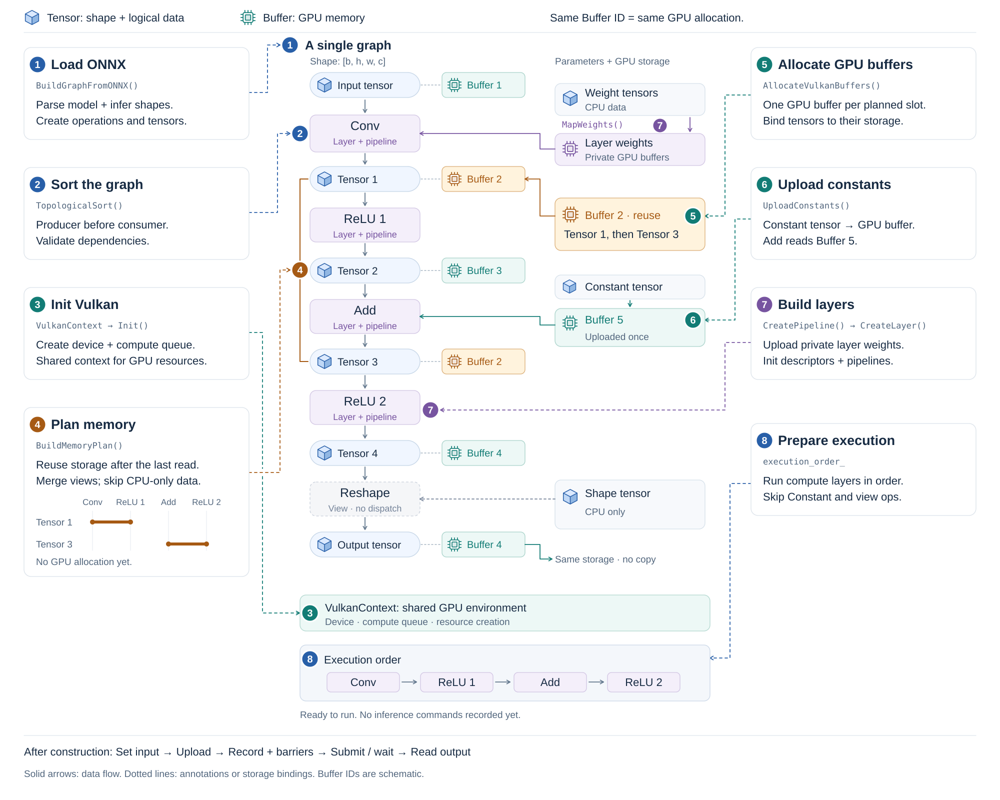
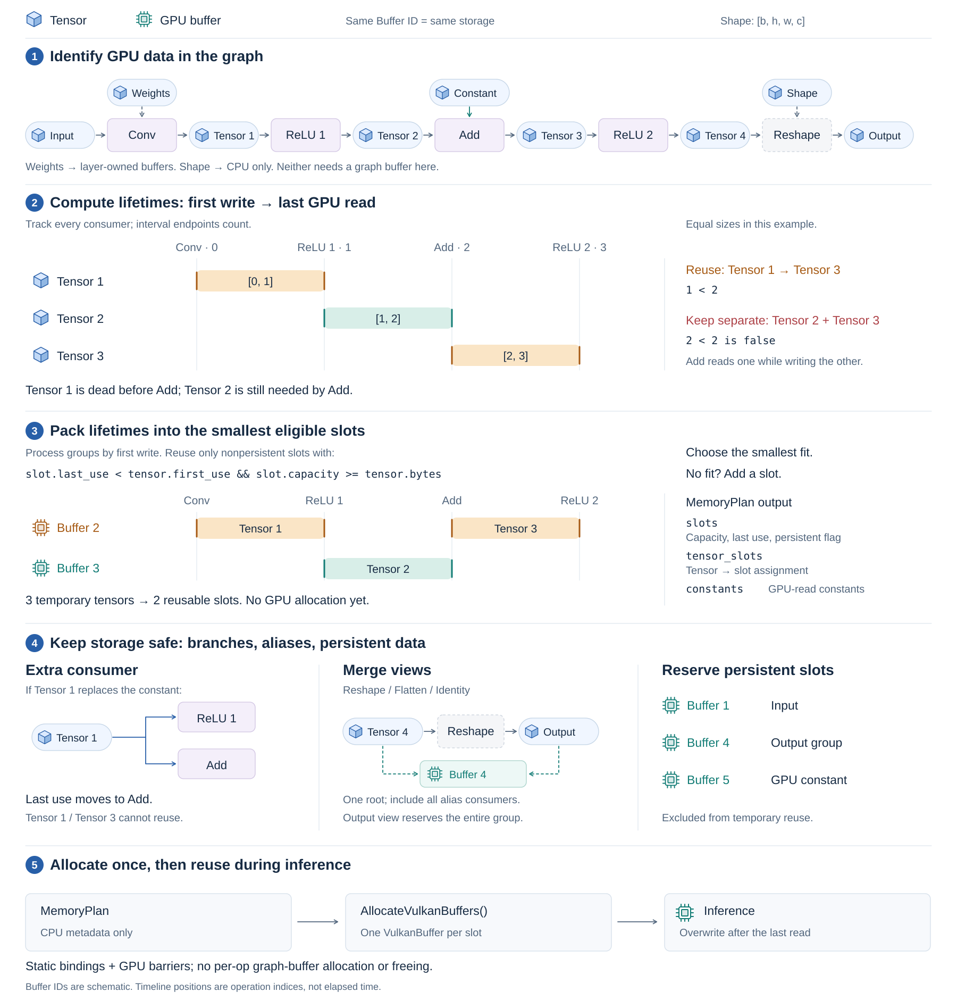

# VKAI

Vulkan AI inference engine for any GPUs, any platforms.

## Workflow

VKAI parses ONNX, infers tensor shapes, and builds a graph. It sorts operations
by dependency, initializes Vulkan, plans and allocates GPU storage, uploads
constants, and creates layers and compute pipelines. Inference uploads inputs,
records commands and barriers, submits work to the GPU, waits for completion,
and reads back outputs.



The memory plan assigns tensor storage by lifetime. Intermediate tensors reuse
buffers after their last GPU consumer; reshape views share storage. CPU-only
parameters receive no graph buffer, while inputs, outputs, and GPU constants
keep dedicated storage.



See [current model measurements](#model-parameters-memory-and-latency) for
validation results, memory use, and timings.

## Setup

Requires CMake ≥3.26, a C++20 compiler, Python 3.11, uv, and the Vulkan SDK
(glslc and MoltenVK on macOS). Run commands from the repository root.

```bash
git submodule update --init --recursive
# Replace with your installed Vulkan SDK setup script:
source /path/to/VulkanSDK/setup-env.sh

uv venv --python 3.11 .venv
uv pip install --python .venv/bin/python -r python/models/requirements-yolo.txt
```

## Prepare model tests

Unit tests generate their own data. For model tests, run these once to download
pretrained weights and sample images, then export ONNX models, inputs, and reference outputs:

```bash
.venv/bin/python python/models/export_resnet18.py
.venv/bin/python python/models/export_unet.py
.venv/bin/python python/models/export_mobilenet_v2.py
.venv/bin/python python/models/export_yolov8n.py
.venv/bin/python python/models/export_dncnn.py
.venv/bin/python python/models/export_lraspp.py
```

Files are cached in `python/models/artifacts/` and shared by both platforms.

## Build and run tests

`build.sh` configures, compiles, and runs the selected tests. Android deployment
is automatic. Each C++ model test reads the exported PyTorch ground truth and
validates its own outputs. Python prepares models and optionally renders images;
model execution and comparison run entirely in C++.

Each network has its own C++ entry point directly in `tasks/`:
`ResNet18Test.cpp`, `UNetTest.cpp`, `MobileNetV2Test.cpp`, `YOLOv8nTest.cpp`, `DnCNNTest.cpp`,
and `LRASPPTest.cpp`.
They build as `vkai_{resnet18,unet,mobilenet_v2,yolov8n,dncnn,lraspp}_test`; each executable
also supports GPU timing with `--benchmark`.

The YOLOv8n C++ test also draws boxes, COCO class names, and confidence scores on
the original image and saves `python/models/artifacts/yolov8n/<platform>_detections.png`.
Android generates the PNG on the device and automatically pulls it back to the host.

DnCNN validates RGB denoising against PyTorch and requires a PSNR improvement of
at least 3 dB against the clean image. Its C++ test saves `<platform>_noisy.png`,
`<platform>_denoised.png`, and `<platform>_comparison.png` in
`python/models/artifacts/dncnn/`. The comparison shows noisy input, Vulkan output,
and clean reference. Android renders these images on the device and pulls them back.

LR-ASPP uses pretrained MobileNetV3-Large for 21-class semantic segmentation at
320×320. It validates raw logits and an independently exported PyTorch argmax mask,
then saves class-ID, colored mask, overlay, and comparison PNGs in
`python/models/artifacts/lraspp/`. The comparison shows input, PyTorch mask,
VKAI mask, and VKAI overlay with a class legend. Android renders and returns the
same images. See the [LR-ASPP results and reproduction steps](python/models/LRASPP_REPORT.md).

```bash
# macOS
./scripts/build.sh -t macos -r unittests
./scripts/build.sh -t macos -r models

# Android arm64: install NDK / adb and connect a device with USB debugging enabled.
export ANDROID_NDK_ROOT="/path/to/android-ndk"
adb devices
./scripts/build.sh -t android -r unittests
./scripts/build.sh -t android -r models
```

Default: `-t macos -r unittests`. `models` validates all six networks and benchmarks
MobileNetV2 / YOLOv8n / DnCNN / LR-ASPP. Both platforms pass all 110 unit tests and all six model tests.
See [model instructions](python/models/README.md) for output files and individual runs.

For compilation only (as in CI), use `./scripts/build.sh -t macos -r 0` or
`./scripts/build.sh -t android -r 0`. This builds all targets without running tests;
no model data or Android device is required.

## Model parameters, memory, and latency

Measured on 2026-10-21 and 2026-10-22 using the current optimized code: Release, FP32, batch=1,
RGB input, default clocks. Both macOS 27.0.1 / Apple M6 / MoltenVK and
Android 13 / Adreno 740 passed **110/110 unit tests and 6/6 model tests**.
GPU times are the mean of 30 runs after 5 warm-up runs.

| Model                     | Input   | Parameters | Vulkan memory (MiB) | macOS GPU (ms) | Android GPU (ms) |
| ------------------------- | ------- | ----------: | -------------------: | --------------: | ----------------: |
| ResNet-18                 | 224×224 | 11,689,512 | 52.08               | 18.17          | 135.73           |
| U-Net                     | 256×256 | 7,763,041  | 85.13               | 138.82         | 1075.42          |
| MobileNetV2               | 224×224 | 3,504,872  | 26.28               | 7.46           | 36.43            |
| YOLOv8n                   | 640×640 | 3,151,904  | 49.27               | 46.85          | 358.86           |
| DnCNN                     | 256×256 | 668,227    | 36.05               | 393.90         | 3143.81          |
| LR-ASPP / MobileNetV3-Large | 320×320 | 3,221,538  | 38.82               | 12.56          | 87.58            |
